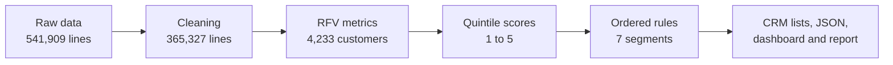
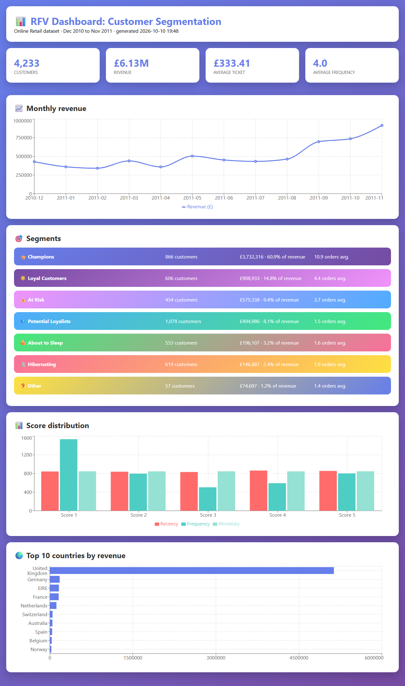

<div align="center">

# 📊 RFV Analysis: Customer Segmentation

**From 541,909 raw invoice lines to 7 actionable customer segments, CRM-ready lists and an interactive dashboard**


[](https://colab.research.google.com/github/Laurentius96/Model_for_Analyzing_RFV_Metrics/blob/main/notebooks/main_analysis.ipynb)

<p>
  <a href="#-overview">Overview</a> •
  <a href="#-dataset">Dataset</a> •
  <a href="#-pipeline">Pipeline</a> •
  <a href="#-segmentation">Segmentation</a> •
  <a href="#-key-insights">Insights</a> •
  <a href="#-interactive-dashboard">Dashboard</a> •
  <a href="#-how-to-use">How to Use</a> •
  <a href="#-limitations-and-next-steps">Limitations</a> •
  <a href="#-license">License</a>
</p>

</div>

---

## 🔍 Overview

Which customers bring the most value, which ones are slipping away, and what should marketing do about each group? This project answers those questions with an **RFV (Recency, Frequency, Value)** analysis of a UK-based online retailer:

| | |
|---|---:|
| 🧾 Raw invoice lines | 541,909 |
| ✅ Clean lines used | 365,327 (67.4%) |
| 👥 Customers segmented | 4,233 |
| 💷 Revenue analysed | £6.13M |
| 📅 Period | 1 Dec 2010 to 30 Nov 2011 |

> **Headline:** 👑 **Champions are 20.5% of the customers and generate 60.9% of the revenue.**

> Built as a DNC School Data Science challenge.

## 📊 Dataset

[Online Retail dataset](https://archive.ics.uci.edu/dataset/352/online+retail) from the UCI Machine Learning Repository: transactions of a UK-based online store that mainly sells unique all-occasion gifts; many of its customers are wholesalers. The raw file is [`dataset/data.csv`](dataset/data.csv).

<details>
<summary><b>📖 Columns and data-quality findings</b></summary>
<br>

| Column | Description |
|---|---|
| `InvoiceNo` | Invoice number; a leading `C` marks a cancellation |
| `StockCode` | Product code |
| `Description` | Product name |
| `Quantity` | Units per line (negative for returns) |
| `InvoiceDate` | Date and time of the invoice |
| `UnitPrice` | Price per unit (£) |
| `CustomerID` | Customer identifier |
| `Country` | Customer country |

| Finding | Value |
|---|---|
| Missing `CustomerID` | 135,080 lines (24.93%) |
| Missing `Description` | 1,454 lines (0.27%) |
| Exact duplicate lines | 5,268 (0.97%) |
| Cancellation lines | 9,288 (1.71%) |
| Negative `Quantity` | 10,624 (1.96%) |
| `UnitPrice` equal to 0 | 2,515 (0.46%) |
| United Kingdom share | 91.43% of lines, 38 countries in total |
| Transactions on Saturdays | none |

</details>

## 🔄 Pipeline



### Cleaning steps

| Step | Rows left | Removed | % of raw |
|---|---:|---:|---:|
| Raw data | 541,909 | — | — |
| Remove December 2011 (only 9 days of data) | 516,384 | 25,525 | 4.71% |
| Remove lines without `CustomerID` | 389,168 | 127,216 | 23.48% |
| Remove cancellations | 380,620 | 8,548 | 1.58% |
| Keep `Quantity > 0` and `UnitPrice > 0` | 380,580 | 40 | 0.01% |
| Remove values outside the 1st–99th percentiles of `Quantity`, `UnitPrice` and `TotalAmount` | **365,327** | 15,253 | 2.81% |

### RFV metrics and scores

- **Recency:** days since the customer's last purchase, measured from the last date in the clean data (30 Nov 2011)
- **Frequency:** number of distinct invoices
- **Value (Monetary):** total spent, with `TotalAmount = Quantity × UnitPrice`

Each metric is split into **quintiles** and scored from 1 to 5, where **5 is best** (most recent, most frequent, highest value):

| Score | Recency (days) | Frequency (orders) | Monetary (£) |
|:-:|---|---|---|
| 5 | ≤ 12 | > 5 | > 1,794 |
| 4 | 13–31 | 4–5 | 833–1,794 |
| 3 | 32–68 | 3 | 428–832 |
| 2 | 69–176 | 2 | 224–428 |
| 1 | > 176 | 1 | ≤ 224 |

## 🎯 Segmentation

Rules are evaluated **in order** and the first match wins:

| Segment | Rule | Customers | % customers | Revenue | % revenue | Avg. recency | Avg. orders |
|---|---|---:|---:|---:|---:|---:|---:|
| 👑 Champions | R≥4, F≥4, M≥4 | 866 | 20.46% | £3,732,316 | **60.89%** | 11.7 days | 10.9 |
| 🌟 Loyal Customers | R≥3, F≥3, M≥3 | 606 | 14.32% | £908,933 | 14.83% | 33.4 days | 4.4 |
| ⚠️ At Risk | R≤2, F≥2, M≥2 | 454 | 10.73% | £575,338 | 9.39% | 162.5 days | 3.7 |
| 💎 Potential Loyalists | R≥3 | 1,078 | 25.47% | £494,986 | 8.08% | 30.9 days | 1.5 |
| 😴 About to Sleep | R=2, F≤3, M≤3 | 553 | 13.06% | £196,107 | 3.20% | 120.4 days | 1.6 |
| 🪦 Hibernating | R≤2, F≤2, M≤3 | 619 | 14.62% | £146,887 | 2.40% | 271.6 days | 1.0 |
| ❓ Other | everything else | 57 | 1.35% | £74,697 | 1.22% | 185.7 days | 1.4 |

## 💡 Key Insights

| Topic | Finding | Suggested action |
|---|---|---|
| 👑 Concentration | Champions: **20.5% of customers, 60.9% of revenue** | Loyalty perks, early access and referrals; protect this group first |
| 💰 Top 3 segments | Champions, Loyal Customers and At Risk hold **85.1%** of revenue | Prioritize budget on these three |
| 💎 Biggest group | Potential Loyalists: **1,078 customers (25.5%)**, recent but only 1.5 orders | Second-purchase journey with onboarding emails and time-limited incentives |
| ⚠️ Revenue at risk | At Risk: **454 customers, £575K** of historical revenue, 162 days without buying | Personalized win-back, starting with the highest historical value |
| 🔁 Retention | **36.3% of customers bought only once** | Retention is the main growth lever |
| ❓ Other | 57 lapsed customers with one high-value order (avg. ticket £1,293) | Investigate why they left |
| 📈 Seasonality | Revenue climbs from September and peaks in **November 2011 (£916K)** | Plan stock and campaigns for Q4 |

## 💻 Interactive Dashboard

<div align="center">
  
</div>

The notebook generates a self-contained dashboard (React + Recharts), a printable executive report and an index page in [`rfv_analysis/`](rfv_analysis). Download the repository and open `rfv_analysis/index.html` in your browser.

**Deliverables generated by the notebook**

| File | Content |
|---|---|
| `rfv_segmentation_complete.csv` | 4,233 customers with metrics, scores and segment |
| `champions_list.csv` | 866 Champions for a loyalty program |
| `at_risk_urgent.csv` | 454 At Risk customers for a win-back campaign |
| `potential_loyalists_email.csv` | 1,078 Potential Loyalists for email nurturing |
| `segment_summary.csv` | Statistics per segment |
| `online_retail_cleaned.csv` | 365,327 clean transaction lines |
| `dashboard_data.json` | Aggregated data behind the dashboard |
| `index.html`, `dashboard_interactive.html`, `executive_report.html` | Dashboard, report and index page |

## 📁 Project Structure

```
📁 Model_for_Analyzing_RFV_Metrics/
├── 📁 dataset/
│   └── 📄 data.csv                      # Raw Online Retail data (541,909 lines)
├── 📁 notebooks/
│   └── 📓 main_analysis.ipynb           # Full analysis with outputs and charts
├── 📁 rfv_analysis/                     # Everything the notebook exports
│   ├── 📄 *.csv                         # Segments, CRM lists and clean data
│   ├── 📋 dashboard_data.json
│   └── 🌐 index.html, dashboard_interactive.html, executive_report.html
├── 📁 assets/
│   └── 🖼️ dashboard_preview.png
├── 📄 requirements.txt
├── 📄 LICENSE.md                        # CC BY-NC-ND 4.0
└── 📄 README.md
```

## 🚀 How to Use

1. **Clone the repository**

   ```bash
   git clone https://github.com/Laurentius96/Model_for_Analyzing_RFV_Metrics.git
   cd Model_for_Analyzing_RFV_Metrics
   ```

2. **Install the dependencies**

   ```bash
   pip install -r requirements.txt
   ```

3. **Run the notebook** from the `notebooks/` folder (paths are relative to it)

   ```bash
   cd notebooks
   jupyter notebook main_analysis.ipynb
   ```

4. **Open the dashboard:** `rfv_analysis/index.html` in any modern browser.

> 💡 **In Google Colab:** run this in the first cell, then run all cells.
>
> ```python
> !git clone https://github.com/Laurentius96/Model_for_Analyzing_RFV_Metrics.git
> %cd Model_for_Analyzing_RFV_Metrics/notebooks
> ```

## 🧭 Limitations and Next Steps

**Limitations**
- 5,268 exact duplicate lines (0.97% of the raw data) were kept; they can slightly inflate Monetary.
- Scores are quintiles of this customer base, so they are relative; the Frequency quintiles are compressed because 36% of customers have a single order.
- Segment rules are business judgment and were not validated statistically.
- Results are dominated by UK customers (91% of the raw lines).

**Next steps**
- [ ] Compare the rule-based segments with clustering (e.g. K-Means on scaled, log-transformed RFV)
- [ ] Remove exact duplicates and measure the impact on the segments
- [ ] Separate RFV for UK and international customers
- [ ] Predict churn and customer lifetime value (CLV)

## 🤝 Contributing

Contributions, ideas and feedback are welcome!

- 🐛 **Found a bug or something unclear?** [Open an issue](https://github.com/Laurentius96/Model_for_Analyzing_RFV_Metrics/issues/new) describing what happened and how to reproduce it.
- 💡 **Have an idea or a question?** [Open an issue](https://github.com/Laurentius96/Model_for_Analyzing_RFV_Metrics/issues/new) and tell me about it.
- 🔧 **Want to propose a fix?** Fork the repository, create a branch (`git checkout -b fix/short-description`), commit your changes and open a pull request explaining what changed and why.

By contributing, you agree that your contribution is shared under the same license as this project.

## 📜 License

This project is licensed under the [Creative Commons Attribution-NonCommercial-NoDerivatives 4.0 International License (CC BY-NC-ND 4.0)](LICENSE.md).

**What this means:**
- ✅ You may **share** this work with **attribution**
- ❌ You may **not** use it for **commercial purposes**
- ❌ You may **not** distribute **modified versions**

## 🙏 Acknowledgments

- [DNC School](https://www.escoladnc.com.br/) for the challenge
- Daqing Chen for the [Online Retail dataset](https://archive.ics.uci.edu/dataset/352/online+retail) (UCI Machine Learning Repository)

---

<div align="center">

**Lorenzo C. Bianchi** · [GitHub](https://github.com/Laurentius96) · [LinkedIn](https://www.linkedin.com/in/cb-lorenzo/)

</div>
